<picture>
  <source media="(max-width: 768px)" srcset="https://raw.githubusercontent.com/dreverrse/dreverrse/main/assets/m/header.svg?v=1" />
  
</picture>

<div align="center">

<a href="https://github.com/dreverrse"></a>

<a href="https://github.com/dreverrse?tab=followers"></a>
<a href="https://github.com/dreverrse?tab=repositories"></a>


</div>

<picture>
  <source media="(max-width: 768px)" srcset="https://raw.githubusercontent.com/dreverrse/dreverrse/main/assets/m/section-about.svg?v=1" />
  
</picture>

<p align="center">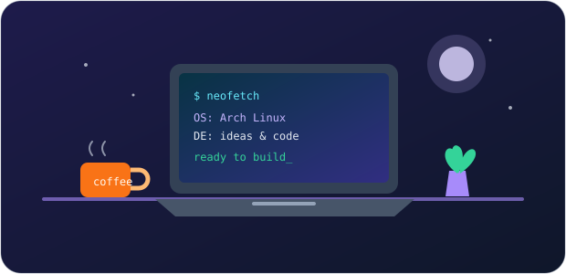</p>

I’m Andre, a frontend and full-stack engineer who likes exploring how things work and building useful things for the web. I enjoy the design side of software as much as the code, and I’m happiest with a terminal open and a new idea to try.

**🚧 Selected work**

- 🌐 **[codenime.xyz](https://github.com/dreverrse/codenime.xyz)** — a web project built with Next.js and Chakra UI
- 🧰 **[hootch-owner-console](https://github.com/dreverrse/hootch-owner-console)** — Hootch Owner Console
- 🐍 **[pochi-gateway](https://github.com/dreverrse/pochi-gateway)** — a Python gateway project

**🧠 What I’m into**

- 🐧 Linux, Arch, and command-line tools
- ⚡ Frontend and full-stack development
- 🐍 Python, JavaScript, and TypeScript
- 🎨 Building interfaces that feel clear and polished
- 🌱 Learning by making and sharing projects

**⚡ Quick facts**

- 📍 Based in Japan
- 💻 I use Arch, btw
- 🤝 Open to interesting projects and open-source collaboration
- 💬 Ask me about web development, Python, or Linux

<picture>
  <source media="(max-width: 768px)" srcset="https://raw.githubusercontent.com/dreverrse/dreverrse/main/assets/m/neofetch.svg?v=1" />
  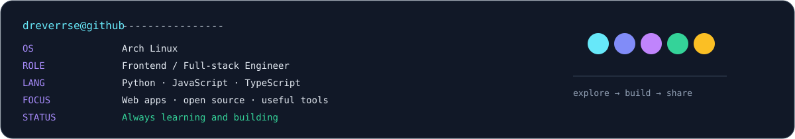
</picture>

> *Stay curious, keep exploring, and keep building.* 🚀

<picture>
  <source media="(max-width: 768px)" srcset="https://raw.githubusercontent.com/dreverrse/dreverrse/main/assets/m/divider.svg?v=1" />
  
</picture>

<picture>
  <source media="(max-width: 768px)" srcset="https://raw.githubusercontent.com/dreverrse/dreverrse/main/assets/m/section-projects.svg?v=1" />
  
</picture>

<p align="center">
  <a href="https://github.com/dreverrse/codenime.xyz">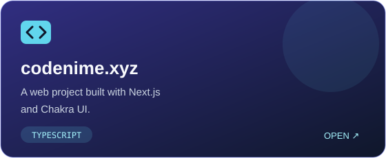</a>
  <a href="https://github.com/dreverrse/hootch-owner-console">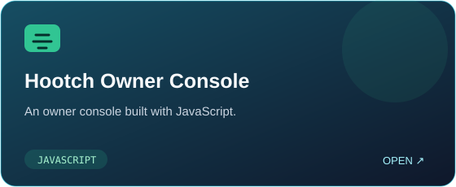</a>
  <a href="https://github.com/dreverrse/pochi-gateway">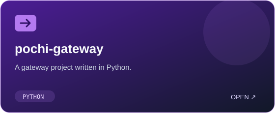</a>
</p>

<p align="center">
  <a href="https://github.com/dreverrse/codenime.xyz"></a>
  
  <a href="https://github.com/dreverrse/hootch-owner-console"></a>
  <a href="https://github.com/dreverrse/pochi-gateway"></a>
</p>

<picture>
  <source media="(max-width: 768px)" srcset="https://raw.githubusercontent.com/dreverrse/dreverrse/main/assets/m/section-journey.svg?v=1" />
  
</picture>

<picture>
  <source media="(max-width: 768px)" srcset="https://raw.githubusercontent.com/dreverrse/dreverrse/main/assets/m/timeline.svg?v=1" />
  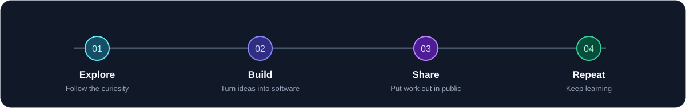
</picture>

<picture>
  <source media="(max-width: 768px)" srcset="https://raw.githubusercontent.com/dreverrse/dreverrse/main/assets/m/divider.svg?v=1" />
  
</picture>

<picture>
  <source media="(max-width: 768px)" srcset="https://raw.githubusercontent.com/dreverrse/dreverrse/main/assets/m/section-stack.svg?v=1" />
  
</picture>

<picture>
  <source media="(max-width: 768px)" srcset="https://raw.githubusercontent.com/dreverrse/dreverrse/main/assets/marquee.svg?v=1" />
  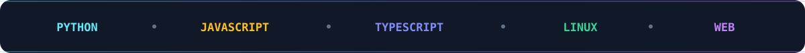
</picture>

<picture>
  <source media="(max-width: 768px)" srcset="https://raw.githubusercontent.com/dreverrse/dreverrse/main/assets/m/stack.svg?v=1" />
  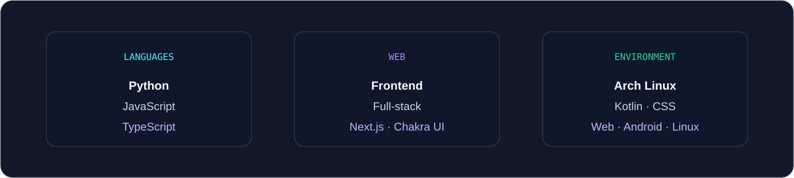
</picture>

<picture>
  <source media="(max-width: 768px)" srcset="https://raw.githubusercontent.com/dreverrse/dreverrse/main/assets/m/section-ai.svg?v=1" />
  
</picture>

<picture>
  <source media="(max-width: 768px)" srcset="https://raw.githubusercontent.com/dreverrse/dreverrse/main/assets/tool-orbit.svg?v=1" />
  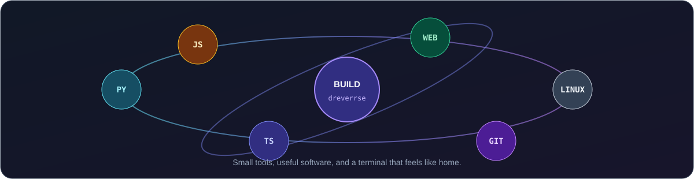
</picture>

<picture>
  <source media="(max-width: 768px)" srcset="https://raw.githubusercontent.com/dreverrse/dreverrse/main/assets/m/divider.svg?v=1" />
  
</picture>

<picture>
  <source media="(max-width: 768px)" srcset="https://raw.githubusercontent.com/dreverrse/dreverrse/main/assets/m/section-stats.svg?v=1" />
  
</picture>

<div align="center">



</div>

<picture>
  <source media="(max-width: 768px)" srcset="https://raw.githubusercontent.com/dreverrse/dreverrse/main/assets/m/section-city.svg?v=1" />
  
</picture>

<picture>
  <source media="(prefers-color-scheme: dark)" srcset="https://raw.githubusercontent.com/dreverrse/dreverrse/output/profile-night-rainbow.svg" />
  <source media="(prefers-color-scheme: light)" srcset="https://raw.githubusercontent.com/dreverrse/dreverrse/output/profile-season-animate.svg" />
  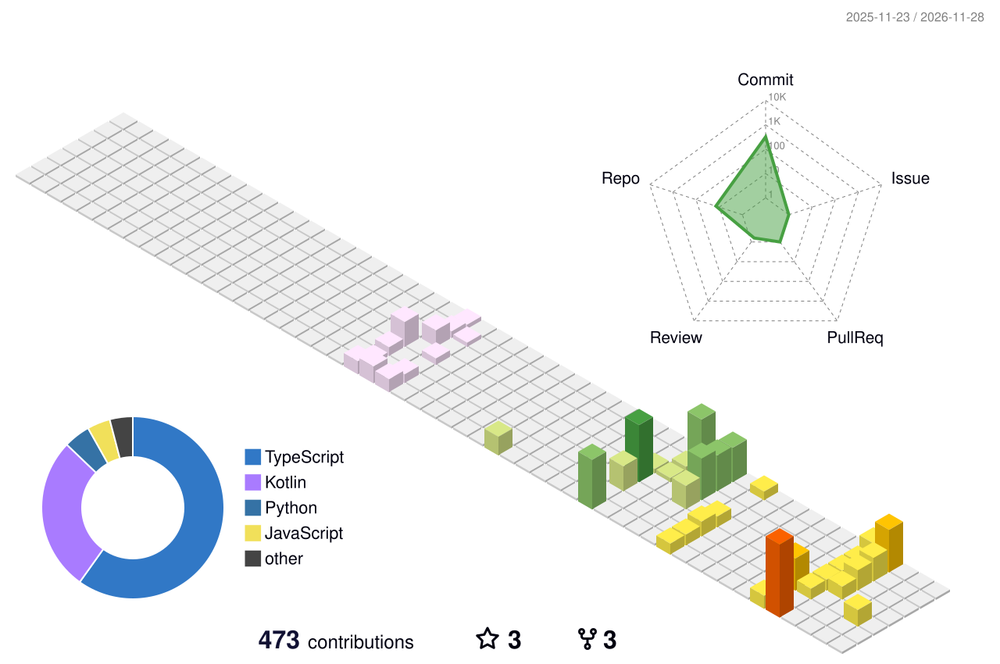
</picture>

<picture>
  <source media="(max-width: 768px)" srcset="https://raw.githubusercontent.com/dreverrse/dreverrse/main/assets/m/divider.svg?v=1" />
  
</picture>

<picture>
  <source media="(max-width: 768px)" srcset="https://raw.githubusercontent.com/dreverrse/dreverrse/main/assets/m/section-arcade.svg?v=1" />
  
</picture>

My commits, eaten by a snake, chased by Pac-Man, and smashed in Breakout. Updated daily.

**🐍 Snake**

<picture>
  <source media="(prefers-color-scheme: dark)" srcset="https://raw.githubusercontent.com/dreverrse/dreverrse/output/github-snake-dark.svg" />
  <source media="(prefers-color-scheme: light)" srcset="https://raw.githubusercontent.com/dreverrse/dreverrse/output/github-snake.svg" />
  
</picture>

**👾 Pac-Man**

<picture>
  <source media="(prefers-color-scheme: dark)" srcset="https://raw.githubusercontent.com/dreverrse/dreverrse/output/pacman-contribution-graph-dark.svg" />
  <source media="(prefers-color-scheme: light)" srcset="https://raw.githubusercontent.com/dreverrse/dreverrse/output/pacman-contribution-graph.svg" />
  
</picture>

**🧱 Breakout**

<picture>
  <source media="(prefers-color-scheme: dark)" srcset="https://raw.githubusercontent.com/dreverrse/dreverrse/output/breakout-contribution-graph-dark.svg" />
  <source media="(prefers-color-scheme: light)" srcset="https://raw.githubusercontent.com/dreverrse/dreverrse/output/breakout-contribution-graph.svg" />
  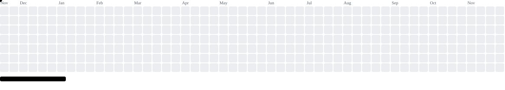
</picture>

<picture>
  <source media="(max-width: 768px)" srcset="https://raw.githubusercontent.com/dreverrse/dreverrse/main/assets/m/divider.svg?v=1" />
  
</picture>

<picture>
  <source media="(max-width: 768px)" srcset="https://raw.githubusercontent.com/dreverrse/dreverrse/main/assets/m/section-guestbook.svg?v=1" />
  
</picture>

<p align="center">Drop a hi! Your message can show up here automatically. 👇</p>

<p align="center"><a href="https://github.com/dreverrse/dreverrse/issues/new?template=guestbook.yml"></a></p>

<!-- GUESTBOOK:START -->
<p align="center"><i>No entries yet. Be the first to sign! ✨</i></p>
<!-- GUESTBOOK:END -->

<picture>
  <source media="(max-width: 768px)" srcset="https://raw.githubusercontent.com/dreverrse/dreverrse/main/assets/m/section-break.svg?v=1" />
  
</picture>

<picture>
  <source media="(max-width: 768px)" srcset="https://raw.githubusercontent.com/dreverrse/dreverrse/main/assets/m/break.svg?v=1" />
  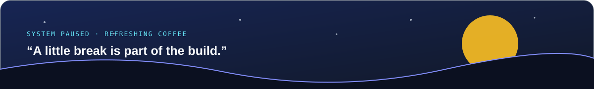
</picture>

<div align="center">

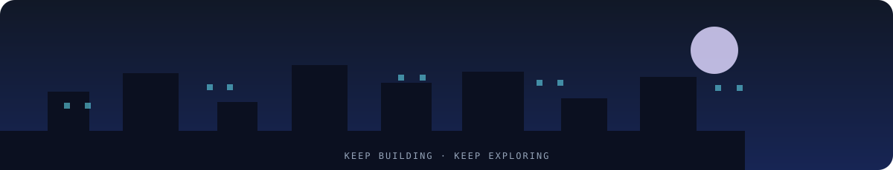

**Thanks for stopping by!** ⭐ Feel free to explore my repositories and say hi.

<details>
<summary>🥚 <b>psst... click me</b></summary>
<br />

```console
$ whoami
Andre Firmansah · dreverrse

$ cat ~/.profile
I use Arch, btw.
Always learning, always building.
```

</details>

</div>
